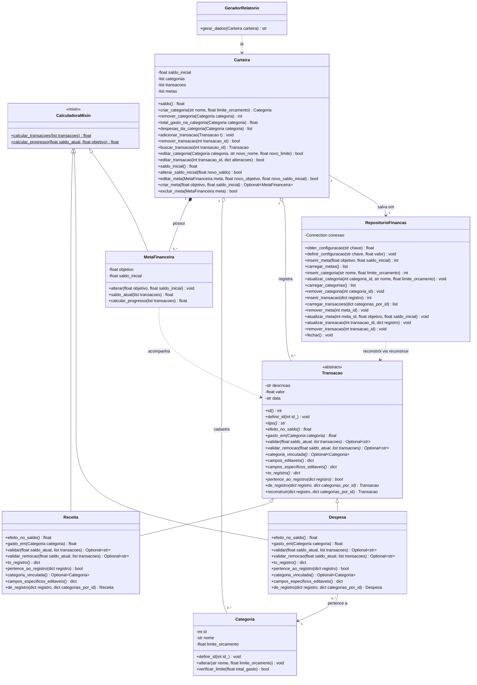
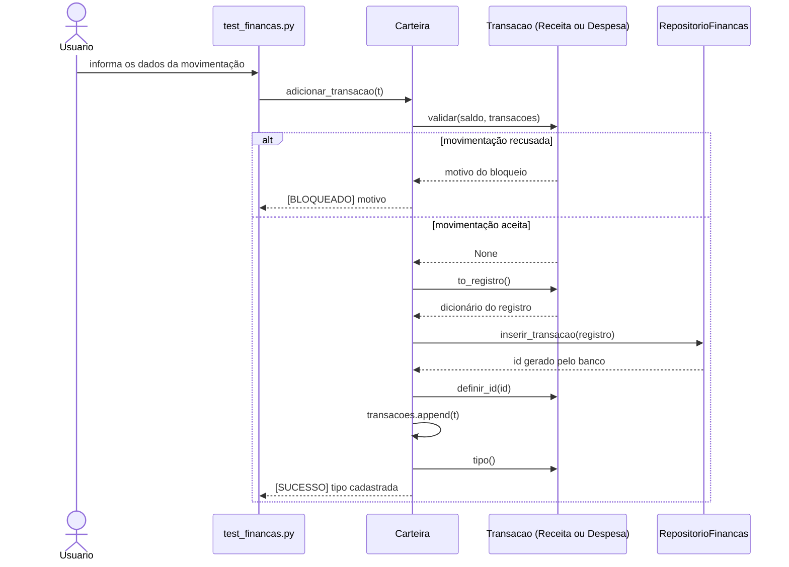

# Modelagem UML — "Gerenciador de Finanças Pessoais"

## 1. Diagrama de classes

### Pontos de polimorfismo

| Método (declarado em `Transacao`) | `Receita` | `Despesa` |
|---|---|---|
| `tipo()` | retorna `"Receita"` | retorna `"Despesa"` |
| `efeito_no_saldo()` | `+valor` | `-valor` |
| `gasto_em(categoria)` | `0` (receita nunca é gasto) | `valor`, se a categoria for a mesma; senão `0` |
| `validar(saldo_atual, transacoes)` | sempre aceita (`None`) | recusa se o total gasto na categoria, com esta despesa, exceder o limite; recusa se o saldo for insuficiente |
| `validar_remocao(saldo_atual, transacoes)` | recusa se o saldo ficar negativo após a remoção | sempre permite (`None`) |
| `to_registro()` | dicionário com `tipo = "Receita"` e `fonte` | dicionário com `tipo = "Despesa"` e `categoria_id` |
| `pertence_ao_registro(registro)` | responde `True` se o registro for do tipo `"Receita"` | responde `True` se o registro for do tipo `"Despesa"` |
| `de_registro(registro, categorias_por_id)` | cria uma `Receita` a partir do registro | cria uma `Despesa` ligada ao objeto `Categoria` correspondente |
| `categoria_vinculada()` | retorna `None` | retorna a própria categoria |
| `campos_especificos_editaveis()` | `fonte` (campo editável só de receitas) | `categoria_id` (campo editável só de despesas) |

Os métodos marcados com `*` são **abstratos**: `Transacao` não pode ser instanciada diretamente, e cada subclasse é obrigada a implementá-los. Com isso, `CalculadoraMixin`, `Carteira`, `RepositorioFinancas`, `MetaFinanceira` e `GeradorRelatorio` tratam todas as movimentações pela mesma interface, exclusivamente por polimorfismo. O método `reconstruir` percorre as subclasses e pergunta a cada uma se o registro é dela.

### Regras de funcionamento

- **Categorias com nome livre:** o usuário cria cada categoria com o nome e o limite de orçamento que escolher. Não podem existir duas categorias com o mesmo nome.
- **Limite de categoria acumulado:** o limite de uma `Categoria` vale para o total gasto nela (soma das despesas já aceitas mais a nova), não para cada despesa isolada.
- **Exclusão de categoria:** ao excluir uma categoria, todas as suas despesas são excluídas junto, e o saldo é recalculado.
- **Remoção de movimentação:** uma receita só pode ser removida se o saldo não ficar negativo; uma despesa sempre pode ser removida.
- **Progresso da meta:** `MetaFinanceira.saldo_atual(transacoes)` é o saldo inicial da meta mais o efeito líquido de todas as transações da carteira. O progresso é esse valor dividido pelo objetivo.
- **Edição:** categorias podem ser renomeadas e ter o limite alterado, desde que o limite não fique abaixo do total já gasto. Movimentações podem ter descrição, valor, data, fonte ou categoria alterados; a versão nova é validada contra as demais movimentações antes de ser gravada.
- **Categoria criada fora da carteira:** ao lançar uma despesa com uma categoria nova, ela só é cadastrada se a despesa passar em todas as validações.
- **Metas:** podem ser criadas, editadas e excluídas pelo menu. A meta inicial só é criada na primeira execução do programa, para que uma meta excluída não volte depois.
- **Saldo inicial e metas:** o saldo inicial pode ser alterado pelo menu. O saldo final da carteira não pode ficar negativo, e o objetivo da meta deve ser maior que zero.
- **Persistência:** inclusão, edição e remoção de movimentações e categorias são gravadas no banco SQLite (`financas.db`) no momento em que acontecem. O saldo inicial e as metas também são salvos (tabelas `configuracoes` e `metas`).

## 2. Diagrama de sequência — adição de uma transação

