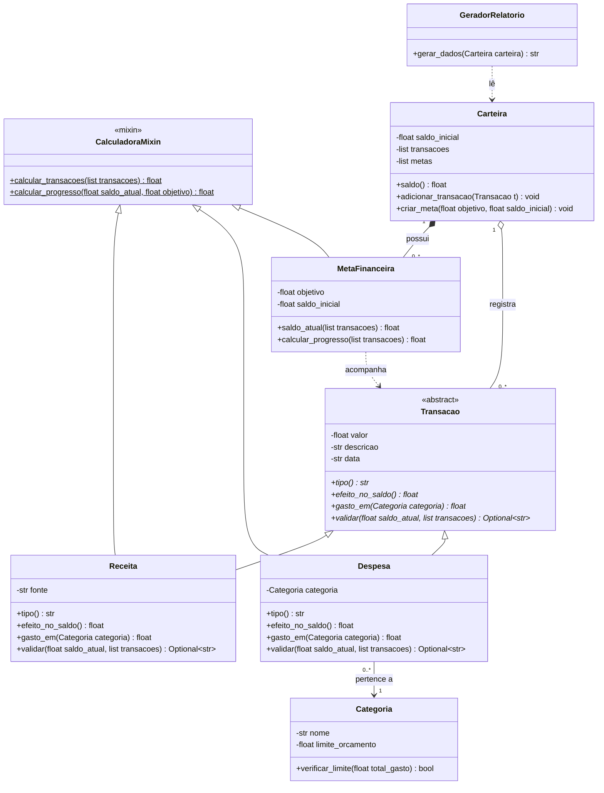
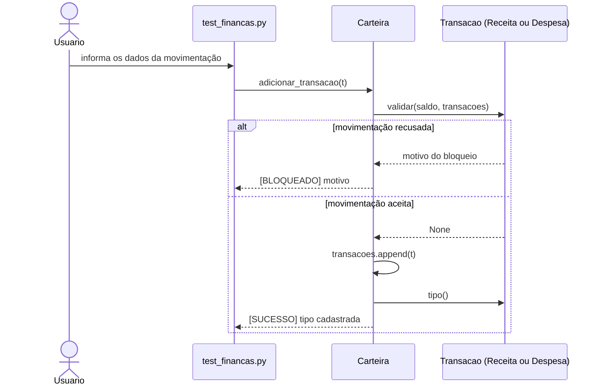

# Modelagem UML — "Gerenciador de Finanças Pessoais"

## 1. Diagrama de classes

### Pontos de polimorfismo

| Método (declarado em `Transacao`) | `Receita` | `Despesa` |
|---|---|---|
| `tipo()` | retorna `"Receita"` | retorna `"Despesa"` |
| `efeito_no_saldo()` | `+valor` | `-valor` |
| `gasto_em(categoria)` | `0` (receita nunca é gasto) | `valor`, se a categoria for a mesma; senão `0` |
| `validar(saldo_atual, transacoes)` | sempre aceita (`None`) | recusa se o total gasto na categoria, com esta despesa, exceder o limite; recusa se o saldo for insuficiente |

Os métodos marcados com `*` são **abstratos**: `Transacao` não pode ser instanciada diretamente, e cada subclasse é obrigada a implementá-los. Com isso, `CalculadoraMixin`, `Carteira`, `MetaFinanceira` e `GeradorRelatorio` tratam todas as movimentações pela mesma interface, exclusivamente por polimorfismo.

### Regras de funcionamento

- **Limite de categoria acumulado:** o limite de uma `Categoria` vale para o total gasto nela (soma das despesas já aceitas mais a nova), não para cada despesa isolada.
- **Progresso da meta:** `MetaFinanceira.saldo_atual(transacoes)` é o saldo inicial da meta mais o efeito líquido de todas as transações da carteira. O progresso é esse valor dividido pelo objetivo.

## 2. Diagrama de sequência — adição de uma transação

